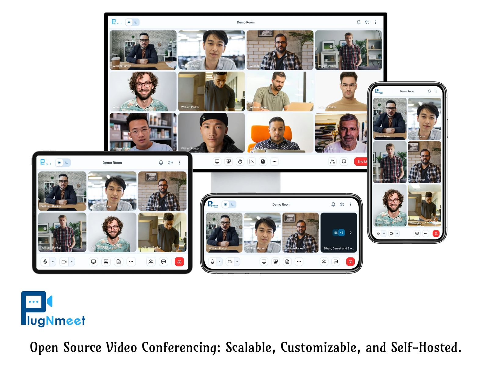

# Plug-N-Meet — Scalable, Customizable, Open-Source Web Conferencing with Native Agentic AI

**The open-source, self-hosted video conferencing software. Scalable, customizable, and with a powerful AI Meeting Agent.**

Plug-N-Meet is built on **Go** for the server and [LiveKit](https://github.com/livekit/livekit-server) for the high-performance WebRTC media layer, and it ships with a native, multimodal **AI Agent** and **Classroom AI Co-Pilot** — not a bolt-on plugin. The agent can speak and listen in real time, draw on the collaborative whiteboard, see participants' work, write shared notes, launch quizzes, and connect to external **MCP (Model Context Protocol)** servers for web knowledge and tool use. The result is a feature-rich, self-hosted conferencing platform you can integrate into any existing website, application, or system.

Have questions or ideas? [Join our developer community on Discord](https://discord.gg/2X2ZaCHu4C) to connect with the team and discuss your suggestions.



## Native Agentic AI & Multimodal Capabilities

Plug-N-Meet treats the AI as a **first-class participant inside the room**, with its own identity, permissions, microphone, whiteboard write/vision access, and shared-note access. It is not a sidebar chatbot bolted onto a meeting — it can act.

*   **Autonomous 1-on-1 Voice & Vision Agent (Virtual Teacher / Assistant)**: Launch a dedicated AI participant that holds a real, spoken conversation with a single participant over **native bidirectional Realtime audio** — **OpenAI Realtime** and **Google Gemini Live**, with instant barge-in — not a slow chained `speech-to-text → LLM → text-to-speech` pipeline. On the **Whiteboard** it draws diagrams, shapes, and text and points at things with a laser cursor, and it visually inspects what the participant drew or wrote on the **Whiteboard canvas** (not a camera feed or screen share). It answers questions, walks through a topic step by step, stays strictly within a server-enforced topic boundary, and generates a structured `AI_AGENT_SESSION_SUMMARY` artifact so the conversation can continue across multiple sessions.
*   **1-on-1 AI Breakout Labs & Auto-Isolated Demo Rooms**: Spin up isolated breakout rooms where each participant gets their own private AI agent session — ideal for language practice, oral exams, interviews, tutoring, or guided demos. Rooms are created, populated, and cleaned up automatically, so a moderator can run a whole classroom of simultaneous 1-on-1 AI sessions without any manual pairing.
*   **Moderator AI Co-Pilot (`ai_text_chat`)**: A moderator-facing co-pilot built into the client and the **Shared Notepad**, which it reads and writes. It understands the meeting context, answers questions about the discussion, inspects and draws on the **Whiteboard**, drafts and previews **Quizzes/Polls** before they are published, and manages **Breakout Rooms** and room settings — all through the same insights/streaming endpoint used by the rest of the AI features.
*   **External MCP (Model Context Protocol) & Web Knowledge**: Connect the agent to external **MCP** servers to give it real tools and real knowledge — search the web, query documentation or a knowledge base, look up records, and call backend APIs. Agent capabilities are configurable per deployment, so you decide which servers, tools, and data sources are in scope.
*   **Live Speech-to-Text, Spoken Translation & Meeting Summarization**: Continuous real-time transcription of the meeting, spoken translation of speech into other languages, and automated end-of-meeting summaries with action items and artifacts — all exposed through the Artifacts API so you can build on top of the results.

## Key Features

*   **High-Performance & Scalable**: Built with Go and leveraging the power of LiveKit, ensuring a robust and lightweight system.
*   **Adaptive Streaming**: **Simulcast** and **Dynacast** support ensures stable calls even on poor networks by intelligently managing video quality and bandwidth. Supported codecs include `H264`, `VP8`, `VP9`, and `AV1`.
*   **Rich Collaboration Tools**: Engage users with HD audio/video, screen sharing, virtual backgrounds, a collaborative whiteboard with office file support (PDF, DOCX, PPTX), shared notepad, polls, and breakout rooms.
*   **Secure & Private Communication**: Features WebRTC-based encryption by default, with optional **End-to-End Encryption (E2EE)** for all media and data channels, ensuring conversations remain confidential.
*   **Telephone Dial-In (SIP Gateway):** Allow participants to join the audio of your meeting by dialing a standard phone number—no internet required.
*   **Flexible Integration**: Easily integrate with any website or system using our straightforward API and SDKs for PHP and JavaScript. Ready-to-use plugins are available for **WordPress**, **Moodle**, and **Joomla**.
*   **Deep Customization**: Easily customize the UI, features, branding, and URLs to match your application's look and feel without modifying core code.
*   **Advanced Broadcasting & Recording**: Includes reliable MP4 recording, RTMP/RTMPS broadcasting to services like YouTube, and RTMP/WHIP ingress for professional production tools like OBS.
*   **Cross-Device Compatibility**: Works on all modern browsers, including Chrome, Firefox, and Safari for iOS, with no downloads required.
*   **Native Mobile App Integration**: Build a custom video conferencing app for iOS, Android, Flutter, React Native, or desktop using the hybrid integration model — combine a native media layer with the full plugNmeet web client UI.

And many more!

## Core Components

1.  **plugNmeet-server**: The primary backend server written in **Go**, handling all API and business logic.
2.  **[plugNmeet-client](https://github.com/mynaparrot/plugNmeet-client)**: The main frontend interface built with **React** and **Redux**.
3.  **[plugNmeet-recorder](https://github.com/mynaparrot/plugNmeet-recorder)**: A dedicated Go application for managing MP4 recordings and RTMP broadcasting.

#### Demo

https://demo.plugnmeet.com/landing.html

## Installation
We've created a simple installation script to deploy all necessary components in minutes.

**View the Complete Installation Guide:** https://www.plugnmeet.org/docs/installation

## SDKs & Tools

### Official SDKs

*   [**PHP**](https://github.com/mynaparrot/plugNmeet-sdk-php)
*   [**JavaScript**](https://github.com/mynaparrot/plugNmeet-sdk-js) (for NodeJS and [Deno](https://github.com/mynaparrot/plugNmeet-sdk-js/tree/main/deno_dist))

### Ready-to-Use Plugins & Integrations

*   [**Joomla** Component](https://github.com/mynaparrot/plugNmeet-joomla)
*   [**Moodle** Plugin](https://github.com/mynaparrot/moodle-mod_plugnmeet)
*   [**WordPress** Plugin](https://github.com/mynaparrot/plugNmeet-wordpress)
*   [**LTI**](https://www.plugnmeet.org/docs/user-guide/lti) for any compatible LMS
*   [**Native Mobile App Integration**](https://www.plugnmeet.org/docs/developer-guide/mobile-app-integration) — build custom iOS, Android, Flutter, React Native, or desktop apps

### Docker Images

*   [plugnmeet-server](https://hub.docker.com/r/mynaparrot/plugnmeet-server)
*   [plugnmeet-recorder](https://hub.docker.com/r/mynaparrot/plugnmeet-recorder)

Full server API documentation is available in the [API Docs](https://www.plugnmeet.org/docs/api/intro).

## Manual installation

**Requirements:**
1.  A properly configured **LiveKit** instance.
2.  **Redis** for caching and messaging.
3.  **MariaDB** or **MySQL** for data storage.
4.  (Optional) `libreoffice` & `mupdf-tools` for office file support in the whiteboard.

Create a `config.yaml` from the `config_sample.yaml` and modify it with your environment details.

***Using docker***

```
docker run --rm -p 8080:8080 \
    -v $PWD/config.yaml:/config.yaml \
    mynaparrot/plugnmeet-server \
    --config /config.yaml \
```

You can also follow [docker-compose_sample.yaml](https://raw.githubusercontent.com/mynaparrot/plugNmeet-server/main/docker-compose_sample.yaml) file.

## Development

Please follow [this article](https://www.plugnmeet.org/docs/developer-guide/setup-development) for details.

## Contributing

We welcome your suggestions for improving plugNmeet!
Let's chat [on Discord](https://discord.gg/2X2ZaCHu4C) to discuss your suggestions and/or PRs. 
